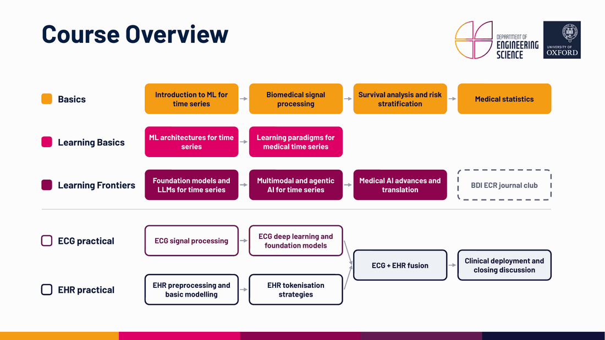

# M04 Machine Learning for Time Series

EPSRC CDT in Healthcare Data Science, University of Oxford. Cohort 8, 2026/27.

Monday 2 to Friday 6 November 2026. 

## Course overview

## Timetable

| Day | Time | Type | Title | Lead |
|---|---|:---:|---|---|
| Mon 2 Nov | 9:00 to 10:15 |  | Introduction to ML for time series | Xiao Gu |
| | 10:45 to 12:00 |  | Biomedical signal processing | Xiao Gu |
| | 13:00 to 16:00 |  | **[P01 ECG signal processing](P01_ECG_signal_processing)** | Junjie Chen |
| Tue 3 Nov | 9:00 to 10:15 |  | Survival analysis and risk stratification | Joshua Fieggen |
| | 10:45 to 12:00 |  | ML architectures for time series | Yujiang Wang |
| | 13:00 to 14:15 |  | **[P02 EHR preprocessing and basic modelling](P02_EHR_preprocessing)** | Yujiang Wang |
| | 14:45 to 16:00 |  | **[P03 EHR tokenisation strategies](P03_EHR_tokenisation)** | Pati Palo |
| Wed 4 Nov | 9:00 to 10:15 |  | Learning paradigms for medical time series | Yujiang Wang |
| | 10:45 to 12:00 |  | Medical statistics | Lei Clifton |
| Thu 5 Nov | 9:00 to 10:15 |  | Foundation models and LLMs for time series | Xiao Gu |
| | 10:45 to 12:00 |  | Multimodal and agentic AI for time series | Edward Phillips and Yixuan Chen |
| | 13:00 to 16:00 |  | **[P04 ECG deep learning and foundation models](P04_ECG_deep_learning_and_FMs)** | Junjie Chen |
| Fri 6 Nov | 9:00 to 10:15 |  | Medical AI advances and translation | David Clifton |
| | 11:00 to 12:00 |  | BDI ECR journal club | Xiao Gu |
| | 13:00 to 14:15 |  | **[P05 ECG and EHR fusion](P05_ECG_EHR_fusion)** | Edward Phillips |
| | 14:45 to 16:00 |  | **[P06 Clinical deployment and closing discussion](P06_Clinical_deployment)** | Bradley Segal |

Please check Canvas for the lecture slides and notes. 

## Working in Colab

1. Check that you can sign in to [Google Colab](https://colab.research.google.com) with a Google account.
2. Open each notebook with its **Open in Colab** button.
2. Save your own copy with **File > Save a copy in Drive**. Colab resets the session after a period of inactivity, and unsaved work is lost.
3. Switch to a GPU (**Runtime > Change runtime type**) when the notebook asks you to.

If you get stuck, ask the practical lead or a tutor during the session.

